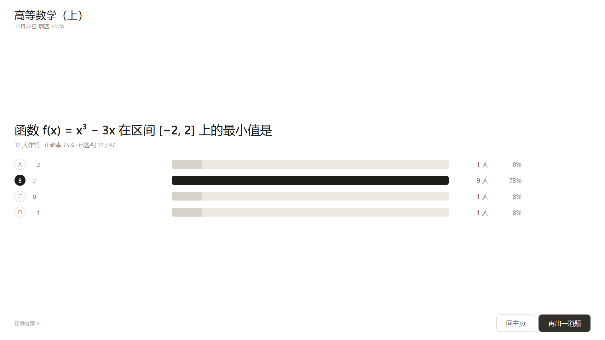
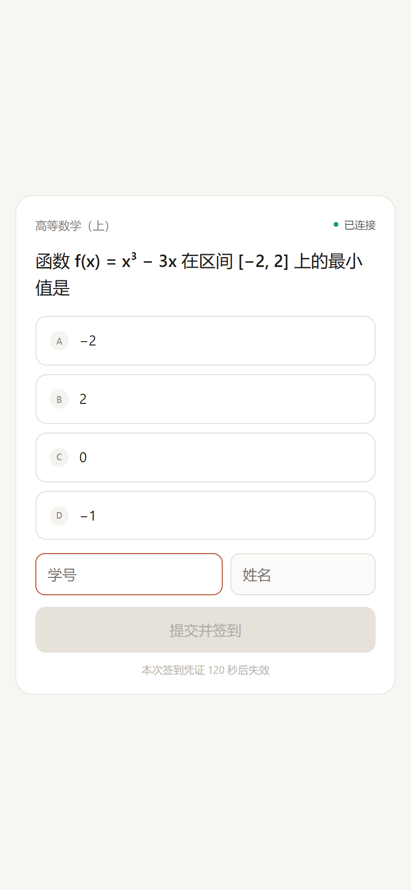
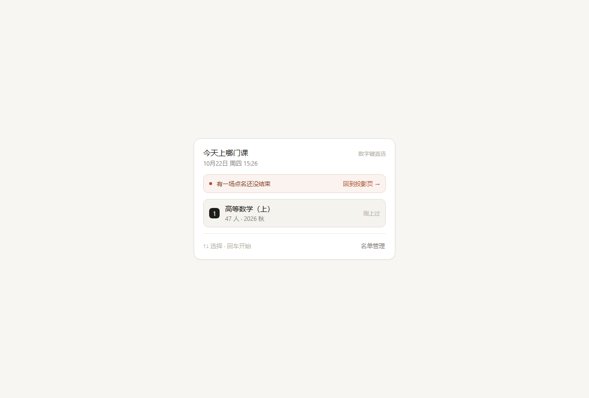
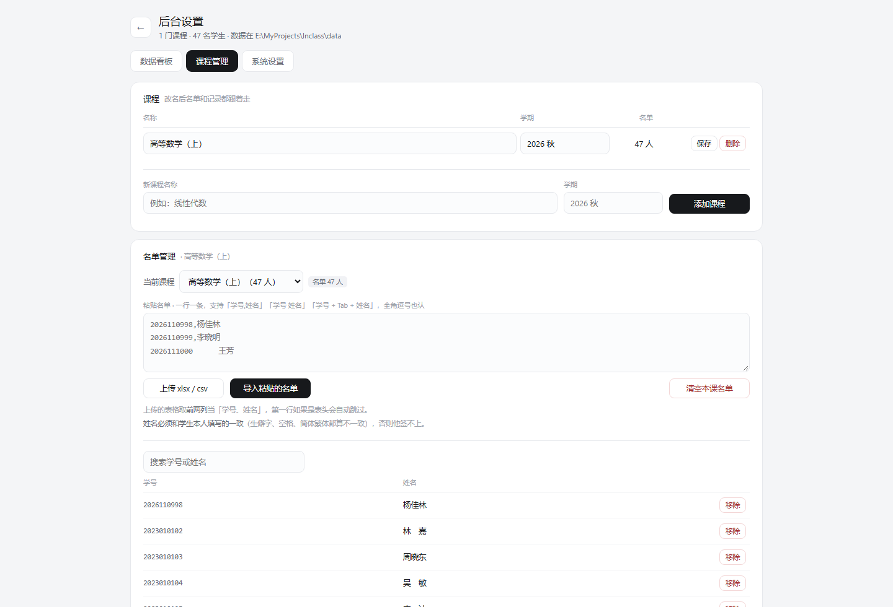

# ClassFlow · 课中签到

把「课堂点名」和「随堂一道题」合并成一次扫码：学生扫投影上的二维码、答一道题，**答完即签到**。老师在大屏上实时看到谁还没到，答完立刻看到全班选项分布，顺势讲评。

> 一个 Node 进程、五张静态页面、零框架。数据全部存在老师本机，不经过任何服务器。


---

## 三条路，挑一条走

代码只有一份，但装的人不一样。对着下面这张表选：

| 你 | 走哪条 | 需要准备 |
|---|---|---|
| 会敲命令，自己就能搞定 | [路径一](#路径一命令行30-秒) | Node.js 18+ |
| 不想碰命令，但手边有 WorkBuddy 或别的 AI 助手 | [路径二](#路径二把这件活交给智能体) | 一条指令，剩下的它干 |
| 只会双击图标 | [路径三](#路径三下载发行包双击就用) | 一个压缩包，**不用装任何东西** |

三条路装完之后用法完全一样，直接看 [一堂课怎么用](#一堂课怎么用)。

---

### 路径一：命令行（30 秒）

需要 [Node.js](https://nodejs.org) 18 或更高版本，Windows / macOS / Linux 都行。

```bash
git clone https://github.com/Caspainnn/class-flow.git
cd class-flow/server
npm install
node server.js
```

看到 `http://127.0.0.1:3000/` 就打开它。

首次运行会自动生成演示数据（1 门课、47 个虚拟学生），到 `/admin` → 课程管理里换成自己的课程和名单。

Windows 用户也可以直接双击根目录的 `课中签到.bat`，效果一样，省一个终端窗口。

---

### 路径二：把这件活交给智能体

如果你在用 WorkBuddy（或任何能在这台电脑上执行命令的 AI 助手），**不用自己看懂上面那些**。把下面整段复制过去，它就知道要做什么：

```text
帮我在这台 Windows 电脑上装好 ClassFlow（课中签到）。我是一线教师，不懂命令行，
每一步做完告诉我结果就行。按下面的顺序做，遇到问题先自己排查，实在不行再问我。

1. 环境
   - 运行 node -v，需要 18 及以上。没有就装：winget install OpenJS.NodeJS.LTS；
     没有 winget 就从 https://nodejs.org 下载 LTS 安装包，装完重开终端再验证。
   - 确认有 git；没有就用这个 zip 代替 clone：
     https://github.com/Caspainnn/class-flow/archive/refs/heads/main.zip

2. 放哪儿
   - 选一个短路径，例如 D:\ClassFlow。不要放 C:\Program Files（需要管理员权限，
     程序写不了数据），也不要放 C:\Windows 或桌面深层目录。

3. 装依赖
   - cd D:\ClassFlow\server
   - npm install --omit=dev
     如果卡在下载，换国内镜像：npm config set registry https://registry.npmmirror.com

4. 先跑起来验证
   - node server.js，看到 http://127.0.0.1:3000/ 即成功，先留着这个窗口别关。
   - 浏览器打开 http://127.0.0.1:3000/，五个页面（/、/compose、/live、/admin、
     /join）都要能打开；打不开就把终端里的报错发给我。

5. 换成我的课程和名单（这一步需要我配合）
   - 先问我：课程叫什么、学期是什么、名单怎么给我。
   - 后台在 http://127.0.0.1:3000/admin，课程管理里可以改课程名、粘贴名单
     （每行「学号 姓名」）或直接上传 xlsx；也可以用 /api/courses 和
     /api/students/import 批量灌。
   - 名单灌完，确认这门课显示的人数和我学生的人数对得上。

6. 做成双击就能用
   - pip install pyinstaller
   - 在 D:\ClassFlow 下执行 tools\build.bat，产出 课中签到.exe
   - 再执行 python tools\make-shortcut.py 生成桌面快捷方式
   - 关掉第 4 步那个终端，双击桌面图标，确认服务能起来、浏览器能打开。

7. 最后给我三样东西
   - 桌面图标的名称；
   - 启动日志里那行局域网地址（形如 http://192.168.1.5:3000），我投影时要用；
   - 提醒我：手机要和电脑连同一个 Wi-Fi；第一次启动 Windows 会弹防火墙提示，
     要点「允许」。

注意：
- data 目录里是我的真实名单，不要上传到任何地方，也不要提交到 git。
- 不要把项目放进 C:\Program Files 或 OneDrive 同步目录。
- 改任何代码前先备份，改完告诉我改了哪几个文件。
```

它走完这七步，你手上会有一个桌面图标，和一屋子学生能扫的二维码。

---

### 路径三：下载发行包，双击就用

不想装 Node、也不想看命令，走这条。**发行包里带了 Node 运行时和全部依赖，解压后不联网也能用。**

1. 打开 [Releases](https://github.com/Caspainnn/class-flow/releases/latest)，下载 `class-flow-win64-v3.0.0.zip`（约 50 MB）；
2. 解压到你能记住的位置，比如 `D:\课中签到`。**别放 `C:\Program Files`**，那里要管理员权限，程序写不了数据；
3. 双击里面的 `课中签到.exe`。

第一次会慢 3~5 秒（杀毒软件在扫新文件），之后大约 1 秒。浏览器会自动打开选课页；没弹出来就手动访问 `http://127.0.0.1:3000/`。

**要桌面图标**：右键 `课中签到.exe` → 发送到 → 桌面快捷方式。文件夹要整个留着，把 `exe` 单独拷走会找不到服务端。

第一次启动会给你一门演示课（高等数学（上）、47 个假学生）。换成自己的：

1. 浏览器打开 `http://127.0.0.1:3000/admin`；
2. 「课程管理」里改课程名，或新建一门课；
3. 名单两种录法——**粘贴**（每行 `学号 姓名`，逗号、空格、Tab 都认）或**上传** xlsx / csv（第一列学号、第二列姓名）；
4. 回首页按 `1` 选这门课，开始上课。

包里还有一份 `使用说明.txt`，内容和这里一样，方便打印或贴在讲台上。

---

## 界面

**投影页（给全班看）**——二维码 + 课堂码 + 未签到名单，签一个少一个：


**签到结束，投影变讲评页**——选项分布直接拿来讲：



**学生手机端**——一屏一道题，答完显示「签到成功 · 第 N 位到课」，不透露对错（答案只给老师）：

<p align="center"></p>

<details>
<summary><b>更多界面</b></summary>

选课（404px 小卡片，课前 3 秒点一下就消失）：



出题（一个输入框，回车换行，点字母定正确答案）：


后台看板（出勤率趋势、每人累计、一键导出 xlsx）：



</details>

## 它解决什么问题

课堂点名有两件麻烦事：

1. **慢**——47 个人的班，点一遍名字要 3~5 分钟，还打断了讲课节奏；
2. **假**——喊「到」的代签、拍照发码的代签，老师根本分不清。

ClassFlow 的做法：

- **答题即签到**：学生扫一次码，答一道选择题，出勤和学情同时拿到，全程 20 秒；
- **动态码防拍照**：屏幕上的 4 位课堂码每 3 秒刷新一次，照片发出去 12 秒后就失效；同一台手机本次只能签一个学号；
- **名单双重匹配**：学号、姓名必须同时和名单对上，别的班的学号混不进来；
- **投影即看板**：谁没到，名字一个个挂在屏幕上，学生自己看得见，不用老师点名；
- **顺手讲评**：签到结束，投影直接变成这道题的选项分布图，正确答案一目了然。

## 一堂课怎么用

1. **课前**：双击启动，按 `1` 选中今天的课，自动进入出题页；
2. **讲到一段落**：在出题页写一道题——题干回车换行、选项回车跳下一格、点左侧字母标出正确答案，`Ctrl/⌘ + Enter` 开始点名（`Esc` 回选课）；
3. **学生**：扫投影二维码，答完即签到；迟到的在窗口关闭后 10 分钟内仍可补签，记为迟到；
4. **老师**：投影右栏的未签到名单实时减少，最后剩几个名字一目了然，不用再点名；
5. **收尾**：点「结束本次点名」，投影变成选项分布图，当场讲评；按 `N` 再出一道题循环；
6. **课后**：后台看板看趋势和每人累计，点「导出 xlsx」把记录交给教务处。

## 防代签机制

课堂签到作弊的典型姿势是「人没到，码拍照发过去」。对应的几道锁：

| 机制 | 做法 |
|---|---|
| 动态码 | 4 位码由 HMAC 按 3 秒一片生成，页面上实时刷新，任何时刻只有最近 4 片有效（12 秒），照片传过去就过期 |
| 两步兑换 | 扫码只领到一次性票据（ticket），票据绑定课堂码的时间片，提交时才核销，不可转发重放 |
| 设备指纹 | 服务端给每台设备种一个 cookie，同一台手机本次点名只能签一个学号 |
| 名单匹配 | 学号 + 姓名必须同时命中本课程名单，跨课程、乱填的学号直接拒绝 |
| 网络隔离 | 除学生端 `/s/…`、`/join` 和相关提交接口外，所有页面（含后台）只接受本机访问，学生手机打不开后台 |

如果换成「每人手机定位打卡」这类更重的方案，作弊照样有（虚拟定位），体验还差一截——所以这里选了「动态码 + 名单 + 答题」的组合：挡住绝大部分顺手代签，同时把签到压缩到 20 秒。

## 数据与隐私

- 所有数据都在本机 `data/` 目录：`students.json`（名单）、`courses.json`（课程）、`sessions.json`（每次点名的完整记录）、`.secret`（本机签名密钥）。**不上传、不联网**；
- `data/` 已在 `.gitignore` 里，不会被误提交；`.secret` 删除后已发的票据全部失效，等于「重新开张」；
- 导出的 xlsx 包含：学号、姓名、题目、提交答案、正确答案、是否正确、状态、签到时间；整门课导出多一列「点名批次」；
- 学生端不回传对错，学生看不到正确答案（防止考题泄露），只有老师能在投影讲评页和后台看到。

## 目录结构

```
class-flow/
├── 课中签到.exe        # 发行包里的启动器（源码仓库不含，见 tools/build.bat）
├── 课中签到.bat        # 源码运行时的启动方式（起服务 + 开浏览器）
├── 停止课中签到.bat    # 关闭后台服务
├── icon.ico            # 应用图标
├── docs/               # 设计文档（方案演进 + v3 重构规格）与截图
├── prototype/          # 最早的 HTML 原型，留着看思路
├── tools/
│   ├── launcher.py     # exe 的启动器源码
│   ├── build.bat       # 打包 exe
│   ├── build-release.py# 组装发行包（exe + node 运行时 + 依赖 → dist/*.zip）
│   └── make-shortcut.py# 生成桌面快捷方式
└── server/
    ├── server.js       # 全部路由与业务逻辑（单文件）
    ├── lib/store.js    # JSON 存储 + 首次运行的演示数据
    ├── public/         # 五张静态页面（选课/出题/投影/学生/后台）
    └── legacy-server.js# v2 之前的 HTTPS + 定位版本，仅留档
```

发行包比源码结构多两样：`runtime\node.exe`（自带的 Node 运行时）和 `server\node_modules`（生产依赖）。启动器优先用自带运行时，找不到才回落到系统 PATH。

## 配置项

`data/settings.json`（不填就用默认值）：

| 字段 | 默认 | 含义 |
|---|---|---|
| `codeRefreshMs` | 3000 | 课堂码刷新间隔（毫秒） |
| `ticketTtlMs` | 120000 | 签到票据有效期（毫秒） |
| `windowMs` | 90000 | 本次点名的签到窗口（毫秒），过后转迟到 |
| `lateGraceMs` | 600000 | 迟到补签宽限（毫秒） |
| `tokenGrace` | 3 | 课堂码允许的时间片容差 |

也可以用环境变量改：`PORT`（默认 3000）、`DATA_DIR`（默认项目根目录的 `data/`）、`PUBLIC_ORIGIN`（二维码里写的地址，默认自动探测本机局域网 IP）。多人共用一个教室网络、或者用固定域名访问时，指定 `PUBLIC_ORIGIN` 更稳。

## 常见问题

**学生扫码打不开页面？**
手机和电脑必须在同一个 Wi-Fi；Windows 防火墙第一次会弹「是否允许 Node.js 访问网络」，要点「允许」。投影页左栏二维码下面显示的就是当前有效的局域网地址（`192.168.x.x:3000/join`），以它为准；换了网络，重启服务即可刷新。

**学生能看到正确答案吗？**
不能。提交后只返回「签到成功 · 第 N 位到课」，选项分布只出现在投影讲评页。

**不小心关了浏览器，点名记录还在吗？**
在。签到中关掉投影页，回主页选课程时会出现粉色横幅，一键回到刚才那场；服务端重启后也会自动接上没结束的会话。

**怎么彻底退出？**
点页面上的「退出程序」，或者双击 `停止课中签到.bat`。关浏览器不等于关服务。

**换电脑 / 重装系统，数据怎么搬？**
把 `data/` 整个拷走放回同位置即可；发行包用户直接把整个文件夹复制过去。

**双击 exe 没反应，或者弹框说找不到 Node？**
发行包用户：解压时可能漏了 `runtime` 文件夹，重新解压完整的压缩包，别用只解出 exe 的「单独提取」。
源码用户：装 [Node.js](https://nodejs.org) LTS 后再双击。

## 开发与打包

```bash
cd server
npm install
node server.js        # 端口 3000，改 PORT 环境变量可换
```

打包成免安装 exe（Windows，需要 Python 3.10+）：

```bash
pip install pyinstaller
tools\build.bat                    # 产出根目录 课中签到.exe
python tools\make-shortcut.py      # 可选：生成桌面快捷方式
python tools\build-release.py      # 可选：组装成解压就能双击的发行包
```

`build-release.py` 把 exe、`runtime\node.exe`、`server\`（含生产依赖）打成一个 zip 放进 `dist/`，上传到 GitHub Releases 就是路径三那个包。发新版时改一下 `server/package.json` 的 `version`，zip 名会跟着变。

设计文档（为什么砍掉课时/题库、动态码的参数怎么定）在 `docs/` 下按 01–04 编号，按演进顺序读。

## 许可

[MIT](LICENSE)
